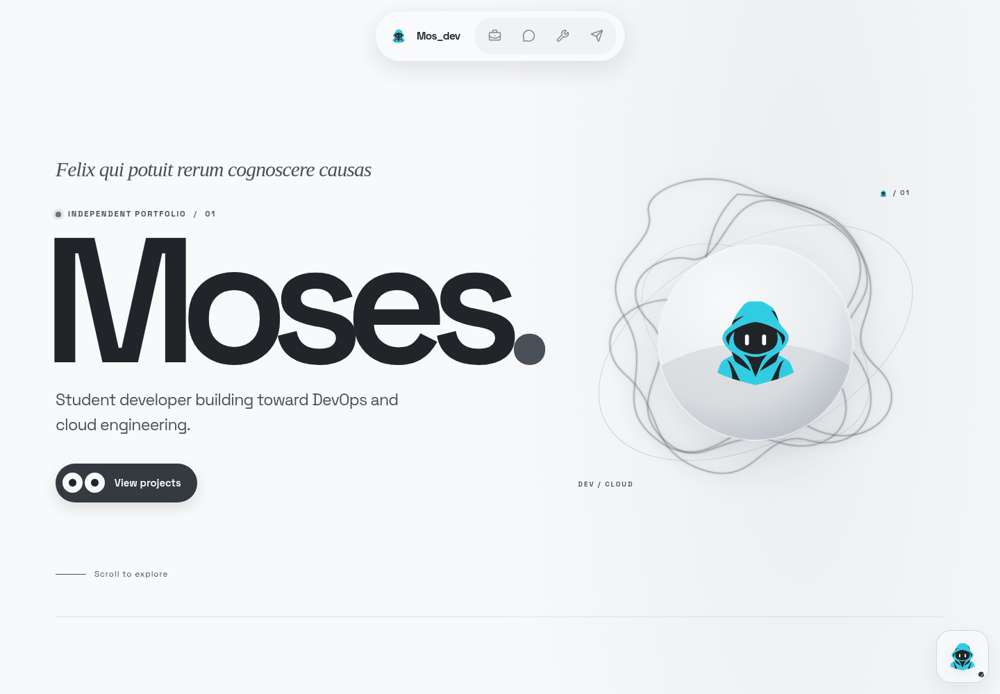
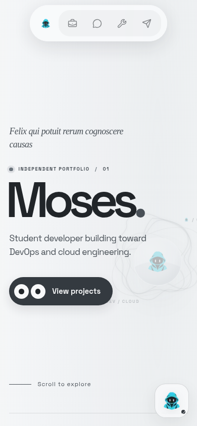

# Mos_dev Portfolio

**Live site:** [portfolio-omega-plum-40.vercel.app](https://portfolio-omega-plum-40.vercel.app/)

A responsive portfolio for Moses, a student developer building toward DevOps and cloud engineering. It brings selected projects, technical skills, testimonials, and contact details together in a polished, theme-aware interface, with a custom mascot and subtle motion.

## Highlights

- Explore four featured projects, with expandable details and repository links.
- Browse the skills and testimonials sections.
- Use the validated contact form to prepare an email draft for review and sending.
- Ask the floating mascot assistant quick questions about the portfolio, projects, and skills.
- Responsive layouts, dark-mode styling, and reduced-motion support.

## Screenshots

<div align="center">
  
  &nbsp;
  
</div>

## Built with

Next.js App Router, React, TypeScript, Tailwind CSS, and Vitest.

## Run locally

```bash
npm ci
npm run dev
```

Run the project checks with:

```bash
npm run lint
npm test
npm run build
```
